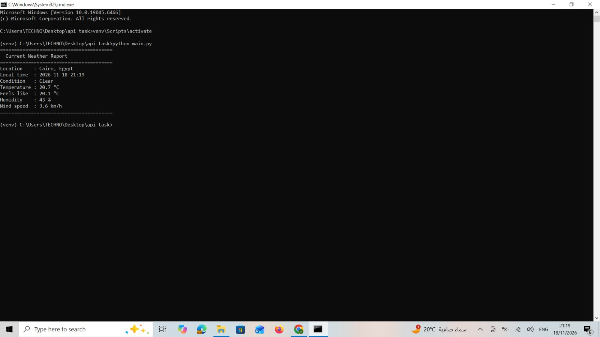

# Weather API Lab

Lab 1 task: a small Python script that gets the current weather for Cairo from WeatherAPI.com and prints it.

The script sends a request to the API, reads the JSON response, saves the values in a `WeatherReport` class, and prints them.

## How to run

1. Create and activate a virtual environment:
```
python -m venv venv
venv\Scripts\activate
```

2. Install the requirements:
```
pip install -r requirements.txt
```

3. Get a free API key from weatherapi.com and put it in a file named `.env` in the project folder:
```
WEATHER_API_KEY=your_key_here
```
The `.env` file is not uploaded to GitHub, so you need to create it yourself.

4. Run it:
```
python main.py
```

## Output



## Files

- `main.py` - the code
- `requirements.txt` - the libraries used (requests, python-dotenv)
- `.gitignore` - keeps `.env` and `venv` out of the repo
